<div align="center">


# PokeTokenBar

**Your AI coding tokens, hatched into Pokémon — right in your menu bar.**

[](https://github.com/w8385/PokeTokenBar-yp/releases)
[](https://www.apple.com/macos/)
[](https://swift.org)
[](LICENSE)
[](https://github.com/sponsors/chattymin)

<a href="https://trendshift.io/repositories/84522?utm_source=repository-badge&amp;utm_medium=badge&amp;utm_campaign=badge-repository-84522" target="_blank" rel="noopener noreferrer"></a>
<a href="https://trendshift.io/repositories/84522?utm_source=trendshift-badge&amp;utm_medium=badge&amp;utm_campaign=badge-trendshift-84522" target="_blank" rel="noopener noreferrer"></a>

**English** · [한국어](README.ko.md) · [日本語](README.ja.md)

</div>

> [!NOTE]
> **PokeTokenBar-yp is an unofficial fork of [chattymin/PokeTokenBar](https://github.com/chattymin/PokeTokenBar) (MIT).** It adds the Pokédex up to #1025 and the [YPoke](bot/README.md) Slack battle bot. Get it from [this fork's releases](https://github.com/w8385/PokeTokenBar-yp/releases). It is not affiliated with or supported by the original project; report fork issues here, not upstream.

PokeTokenBar turns the AI coding tokens you're already burning — Claude Code, Codex, Gemini CLI, Antigravity, OpenCode, Hermes Agent, Cursor, Grok CLI, Copilot CLI, Kiro CLI, Pi Agent, omp, omo, Aside, Kimi Code & Devin CLI — into a growing **Pokémon companion** in your macOS menu bar. Spend tokens, hatch an egg, evolve it through its real evolution line, graduate it into your Pokédex, and start again. Underneath the companion it's a precise usage tracker — today's spend, cost, and official 5-hour / weekly limits, read straight from your local logs.

> Token usage is read directly from local Claude Code, Codex, Gemini CLI, Antigravity, OpenCode, Hermes Agent, Cursor, Grok CLI, Copilot CLI, Kiro CLI, Pi Agent, omp, omo, Aside, Kimi Code, and Devin CLI data (`totalTokens` = input + output + cache, local date) — no external CLI needed. Unofficial, non-commercial Pokémon fan project — see [License & disclaimer](#license--disclaimer).

## Why

- **The usage tracker you actually enjoy opening.** Your spend raises a Pokémon that hatches, evolves, graduates, and fills a Pokédex — and every shiny is a reason to check back.
- See today's token spend & cost at a glance — no dashboard, no browser tab.
- Track official provider limits and reset countdowns, including OpenCode Go allowances and Grok CLI subscription credits; a burn-rate forecast helps with supported 5-hour windows.

<div align="center">
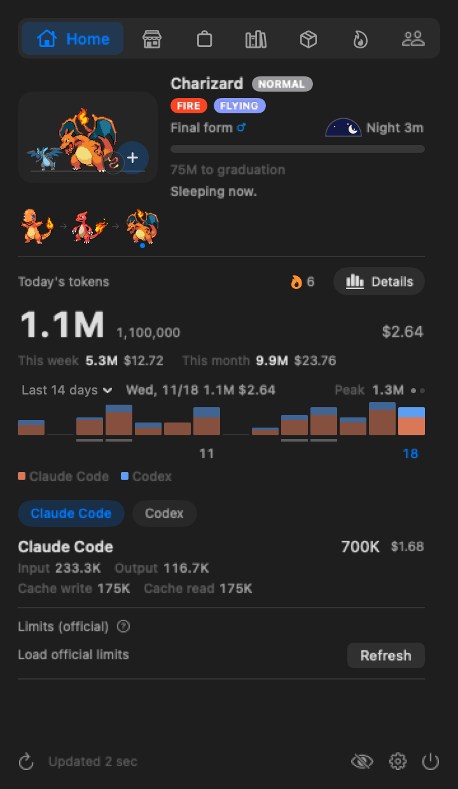
</div>

## How it works

1. 🥚 **Code as usual.** The tokens you burn in Claude Code, Codex, Gemini CLI, Antigravity, OpenCode, Hermes Agent, Cursor, Grok CLI, Copilot CLI, Kiro CLI, Pi Agent, omp, omo, Aside, Kimi Code, or Devin CLI incubate an egg — nothing extra to run.
2. 🐣 **Hatch.** Eggs hatch into Pokémon with real evolution lines from [PokéAPI](https://pokeapi.co/) — any Gen 1–9 line (540 possible starts), weighted by the official capture rate: commons hatch often, a legendary is about a 1-in-48 event. #650 onward use the Pokémon Showdown animated sprites. It appears in your **Pokédex** immediately while you raise it. Every hatch rolls one of 25 natures — and once in a rare while, the egg hatches **✨ Shiny**.
3. ⚡ **Evolve.** Keep coding and it grows through its actual evolution tree (1/2/3 stages, branching), with a little flash celebration at each step. Unusual evolutions (Inkay's upside-down flip, Tyrogue's three branches, friendship evolutions like Pikachu, …) are translated into conditions the app can check; the Pokédex detail shows the original condition and the app condition, and a Pokémon's own detail in the Box shows its progress. Day and night alternate every 10 minutes on the wall clock (day :00–:09, night :10–:19, day :20–:29, …) instead of following the real sun, and the condition shows "Day now · night in 7 min". Home shows a small sun-and-moon dial with the current period and the minutes to the switch. If a Pokémon is ready to evolve but a condition is unmet, you get one notification per blocking reason pointing you to the Pokédex.
4. 🎓 **Graduate & collect.** Final form + threshold permanently archives it in your **Pokédex** — rarer takes longer (≈3 days Normal → ≈24 days Legendary at heavy use) — and a fresh egg arrives.
5. 🍬 **Max out, get a candy.** Fill a 5-hour or weekly usage limit and you earn **Rare Candy** — spend it from the **Bag** to grow your current Pokémon.
6. 🛒 **Spend at the Shop.** Every token you've used is spendable currency — buy **Rare Candy**, a **Mint** that sets your Pokémon's nature to the one you pick, a **Shiny Charm** that permanently raises your shiny odds, or an egg to send off your current companion and start over. Eggs come in three grades: a plain **Pokémon Egg**, a **Rare Egg** guaranteed to hatch Rare or better, and an **Epic Egg** guaranteed to hatch Epic or better. A **Scout Ticket** for each region (or all of them) shows 10 random Pokémon from it so you can pick the egg you want.
7. 🔁 **Trade with coworkers.** Swap graduated Pokémon with a linked coworker from the Friends tab (the other side accepts in Slack), or send a graduated Pokémon straight from its Box detail. Or put one up for **Miracle Trade** in the battle channel: the first coworker to pick one of theirs trades with you at once. Pokémon that evolve by trade, like Haunter or Kadabra, now stop there until they're traded — or until you use a **Linking Cord** from the Shop on one in your Box. Trade evolutions that also need a held item (Onix with Metal Coat, Seadra with Dragon Scale, …) need that item equipped on the Pokémon first, in its Box detail; Karrablast and Shelmet evolve when traded for each other, or with a Linking Cord while the other one is your friend.

## Tour

<table>
<tr>
<td width="45%" align="center"></td>
<td width="55%" valign="middle">
<h3>🐾 Let it live on your desktop</h3>
Move your companion out of the menu bar and onto the desktop, at any size from 48 to 384px. Hover for today's usage, right-click for a menu, and drag it wherever you like. Click an egg to pray or a hatched Pokémon to pet it; clicks never open the popover, so use <b>right-click → Open</b> (or the menu bar icon). Limit alerts can appear as speech bubbles.
</td>
</tr>
<tr>
<td width="45%" align="center">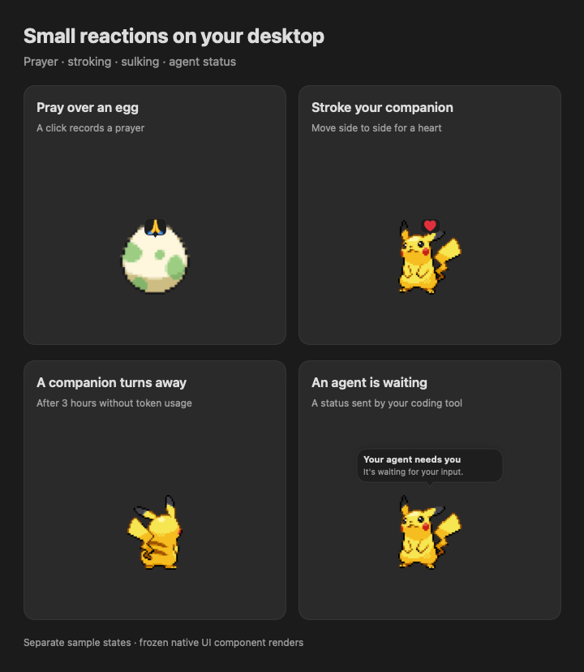<br><small>Native UI components · sample states</small><br><br>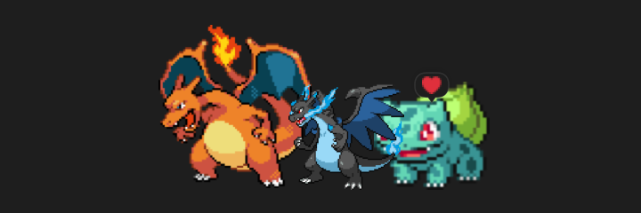<br><br>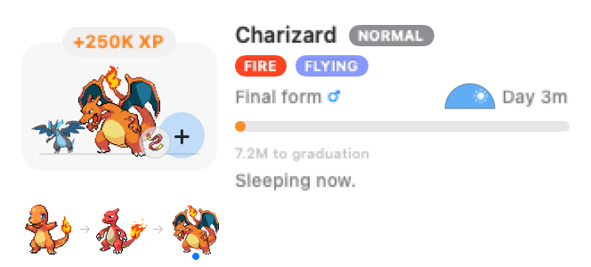<br><small>Sample state</small></td>
<td width="55%" valign="middle">
<h3>A companion with a little personality</h3>
Move the pointer over your floating pet, or click it, to pet it; click an egg to pray, and watch for small reactions, sulking, and occasional event bubbles. Friends stand close beside the pet, slightly overlapping, and petting a friend pops a heart over that friend. These interactions are cosmetic: praying does not change hatch odds or growth rewards. Clicking the big Home sprite or a hatched floating pet does grow it, and every click counts: fast clicks add up in one +XP badge. Every 30 prayers, a quip can accompany a usage refresh. Agent activity can add working, waiting, and done reactions after <a href="#agent-activity">manual setup</a>.
</td>
</tr>
<tr>
<td width="55%" valign="middle">
<h3>In your menu bar</h3>
An animated Gen-V sprite lives next to today's total tokens (compact, e.g. <code>200.7M</code>). Add today's cost (<code>$</code>) or official limit <code>%</code> — or turn everything off for a character-only bar.
Enable <b>Settings → Show in menu bar → Pokémon growth %</b> to see your egg's hatch progress or your companion's progress toward its next evolution or graduation. It updates immediately after Rare Candy use and follows the companion being raised even if a representative Pokémon is pinned.
</td>
<td width="45%" align="center"><br>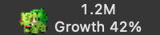</td>
</tr>
<tr>
<td width="45%" align="center"></td>
<td width="55%" valign="middle">
<h3>✨ Once in a rare while — Shiny</h3>
Shiny hatches keep their distinct colors through every evolution — menu bar, home card, evolution line. In the Pokédex, species you own shiny show their shiny colors and a ✨ marker; the detail page lets you switch between owned normal and shiny appearances. Unown keeps its A icon in the grid, with letter and color choices in its details. A dedicated notification makes sure you don't miss the moment.
</td>
</tr>
<tr>
<td width="55%" valign="middle">
<h3>A Pokédex worth filling</h3>
The <b>Pokédex</b> folds every species you've owned into one cell — 16 per page in a 4×4 grid. Search by name or number, filter by rarity or shiny appearance, and change the sort order. Turn pages with the scroll wheel or trackpad, or use the larger arrow hit areas. Click a collected Pokémon in Home's evolution line to open its species page (clicking the big Home sprite grows your companion instead); Back returns to the Pokédex page you came from. The page is about the species — and an "N in your Box" button jumps to the individuals you own.
<br><br>
The <b>Box</b> tab holds every Pokémon you own — the one you're raising, your friends and the graduated ones — with its level, shiny and gender marks, and held item. Search, filter by region, grade, shiny or held item, and sort. Open one for its stats, nature, IVs, moves, evolution progress and the big <b>held item</b> slot: this is the one place to equip, swap or remove an item (locked while the Pokémon is in an open trade). Battle, evolution cards and Home only show the item and link back here.
</td>
<td width="45%" align="center">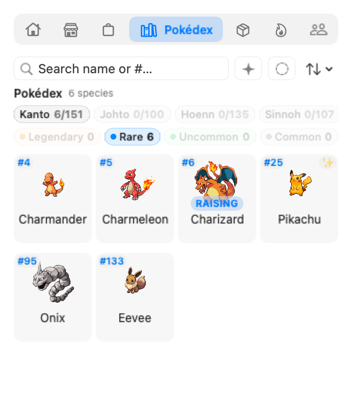<br><br>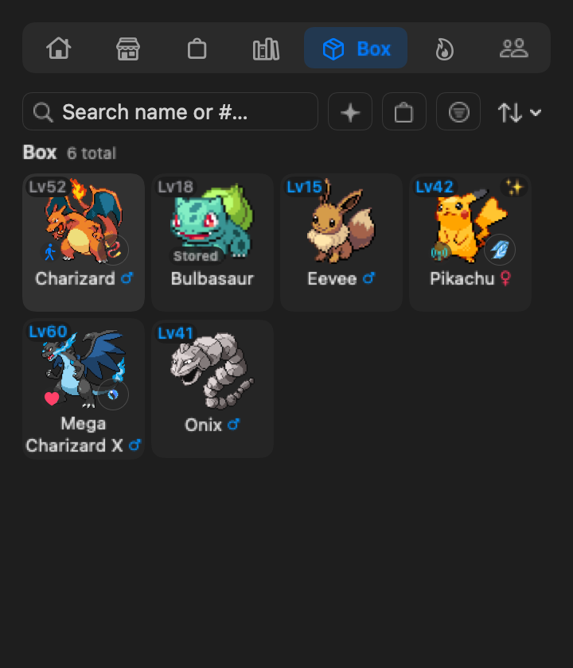</td>
</tr>
<tr>
<td width="45%" align="center">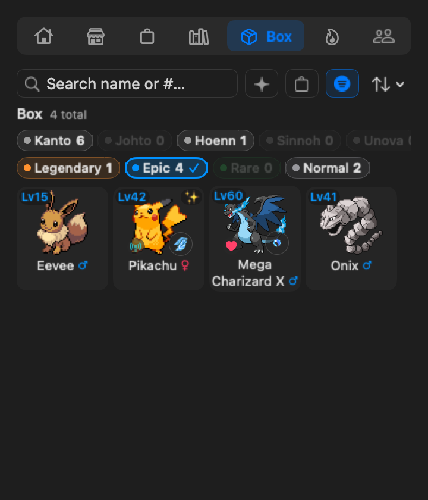</td>
<td width="55%" valign="middle">
<h3>Filter the Box by region and grade</h3>
Two chip rows sit above the Box grid, like the Pokédex header: the regions from Kanto to Paldea, then the grades. Each chip counts the Pokémon in your Box. Click a chip to filter and click it again to clear. One region and one grade can be on at a time, and they combine with search and the filter panel. A Pokémon's region follows its current species, so an Onix that became Steelix counts as Johto.
</td>
</tr>
<tr>
<td width="45%" align="center">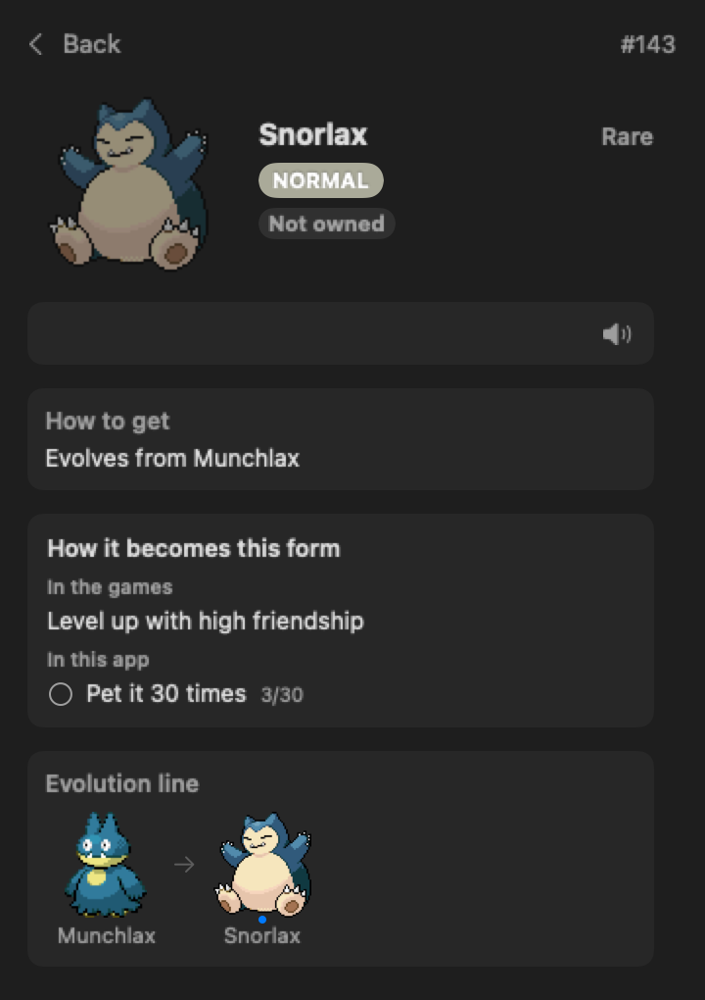</td>
<td width="55%" valign="middle">
<h3>See what comes next</h3>
A species' Pokédex page lists its special evolutions, both into it and out of it: Munchlax's page says "Next: Snorlax · Pet it 30 times". When the species is the one you're raising or the form it's waiting to become, the card shows your live progress, such as 3/30. Pages for species you don't own show the same cards. On Home, a branching line's <b>?</b> opens the raised species' page, which lists every branch's condition.
</td>
</tr>
<tr>
<td width="45%" align="center"><br><small>Native UI components · sample states</small></td>
<td width="55%" valign="middle">
<h3>Complete a region, keep a badge</h3>
Filter the Pokédex to <b>Kanto, Johto, Hoenn, Sinnoh, Unova, Kalos, Alola, Galar, or Paldea</b> and check each region's owned and shiny counts. Collect completion badges for a region, its shiny set, all 28 Unown forms, or the national collection of 1,025 species. Badges record collection milestones and do not change hatch odds or growth.
</td>
</tr>
<tr>
<td width="45%" align="center"><br><small>Production UI rendered locally with sample Pokémon.</small></td>
<td width="55%" valign="middle">
<h3>Collect more than one look</h3>
Collect Rotom appliances, Shaymin's Land and Sky Formes, Deerling seasons, Unown letters, and other supported Gen 1–5 forms. The Pokédex shows your form count and the individuals in each form. Choose an owned form as your menu-bar and floating-pet representative. An East Sea Shellos keeps its appearance when it becomes Gastrodon, and forms stay in saves and exports. Types, stats, abilities, and moves use the default form’s data.
</td>
</tr>
<tr>
<td width="45%" align="center"></td>
<td width="55%" valign="middle">
<h3>Tune it your way</h3>
Choose which tools to track in <b>Settings → Tracked providers</b>. Turning one off stops reading that provider and excludes it from tabs, totals, Pokémon growth, and official-limit requests. Configure menu-bar items, refresh interval (1–15 min or manual), launch at login, and usage or companion alerts. Full <b>KO / EN / JA / ES / FR / PT / DE / RU</b> UI; Pokémon names and metadata fall back to English when a translation is unavailable.
</td>
</tr>
<tr>
<td width="55%" valign="middle">
<h3>🍬 Fill a limit, earn a Rare Candy</h3>
Max out a 5-hour or weekly usage limit and you're handed a <b>Rare Candy</b> — one per 5-hour cap, five per weekly. Spend it from the new <b>Bag</b> tab to grow your current Pokémon: the moment you're rate-limited becomes the moment you level up.
</td>
<td width="45%" align="center">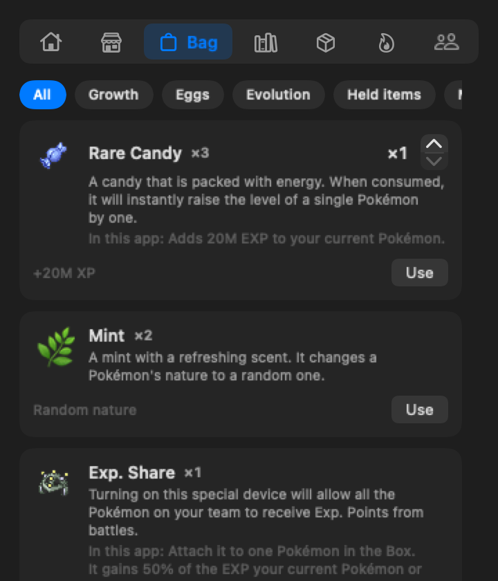</td>
</tr>
<tr>
<td width="45%" align="center">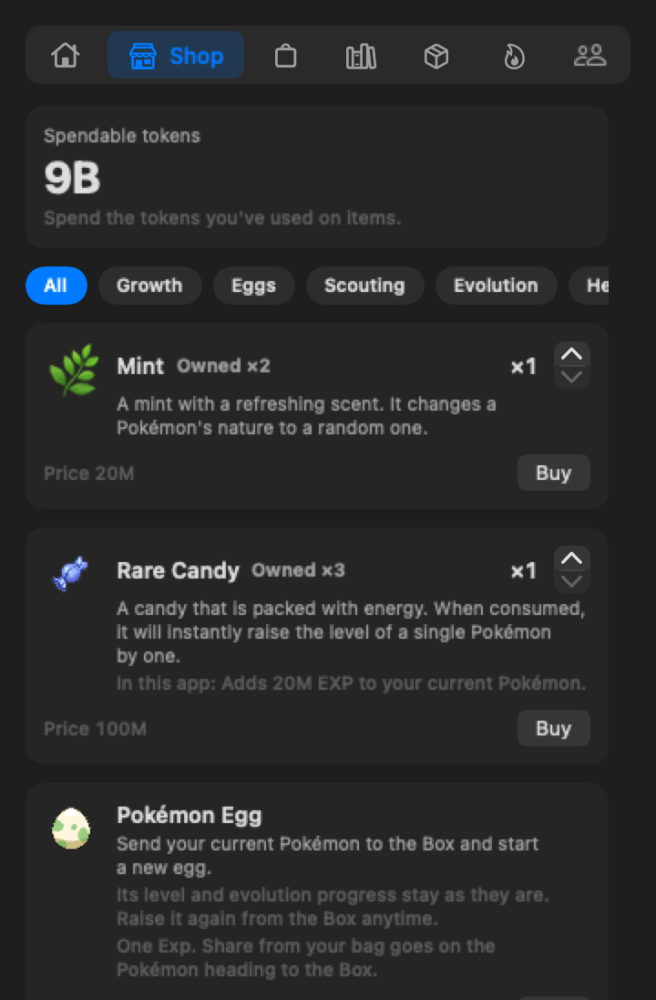</td>
<td width="55%" valign="middle">
<h3>🛒 A shop that runs on your usage</h3>
The tokens you've already used are your currency. Buy several consumables at once with a quantity selector and total-price preview: <b>Rare Candy</b> grows your Pokémon, and a <b>Mint</b> changes its nature to the one you pick. A <b>Shiny Charm</b> permanently raises your shiny hatch odds. Eggs send off your companion and start over: a plain <b>Pokémon Egg</b>, a <b>Rare Egg</b> guaranteed to hatch Rare or better, or an <b>Epic Egg</b> guaranteed to hatch Epic or better. Legendaries stay in both graded pools. An empty Bag links straight to the Shop.
</td>
</tr>
<tr>
<td width="55%" valign="middle">
<h3>⚔️ Battle items, grouped by what they do</h3>
The <b>Held items</b> tab in the Shop and the Bag sorts battle items under short headers: attack boost, type boost, bulk &amp; healing, speed, aim &amp; crits, status &amp; counters, weather and signature items. In the Shop, a second chip row shows one group at a time.
</td>
<td width="45%" align="center">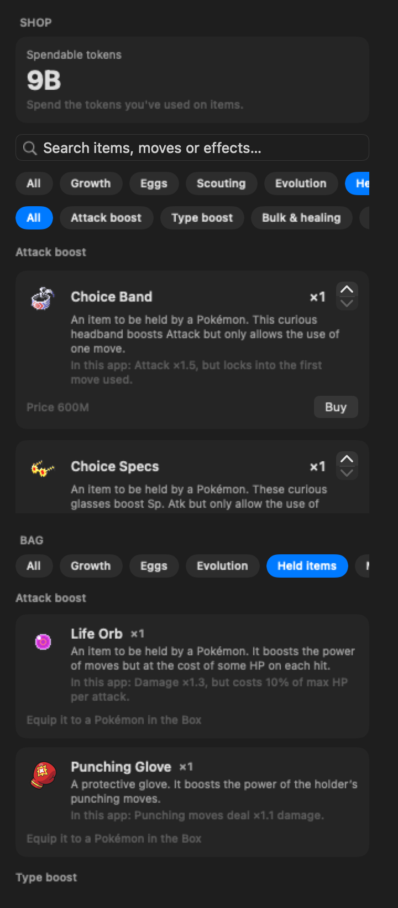</td>
</tr>
<tr>
<td width="45%" align="center">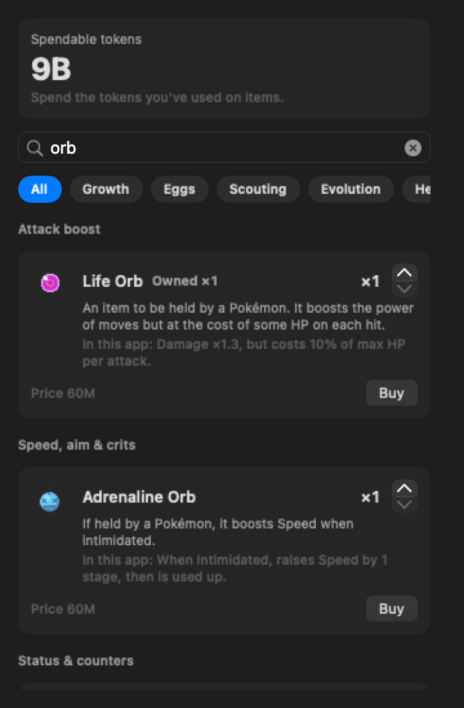</td>
<td width="55%" valign="middle">
<h3>🔎 Search the whole shop</h3>
One search field above the chips covers every item, Mega Stone, egg, scouting ticket and TM. Names match in any of the app's eight languages, so "orb" finds Life Orb in the Japanese UI too, and effect text matches in your language. Results keep the Shop's headers and order whatever chip is picked; clear the field to go back.
</td>
</tr>
<tr>
<td width="55%" valign="middle">
<h3>💥 Every attacking move does what it says</h3>
Every attacking move now works in battles and gyms: added effects such as flinching and burns, recoil, draining and the damage a missed High Jump Kick deals, set damage like Night Shade and Super Fang, one-hit KOs, power that depends on weight, HP or Speed, two-turn moves like Solar Beam and Fly, Outrage and the binding moves, Sucker Punch and Fake Out, Foul Play and Body Press, Future Sight, and Feint breaking through Protect. Two are left out and do nothing: <b>Natural Gift</b> and <b>Fling</b>, because the app keeps no per-berry or per-item power for them. Attacks whose power comes from their effect show <b>Power —</b> in the TM shop and the move picker, and the shop now sells 14 of them as TMs, such as Gyro Ball, Electro Ball, Low Kick and Reversal.
</td>
<td width="45%" align="center">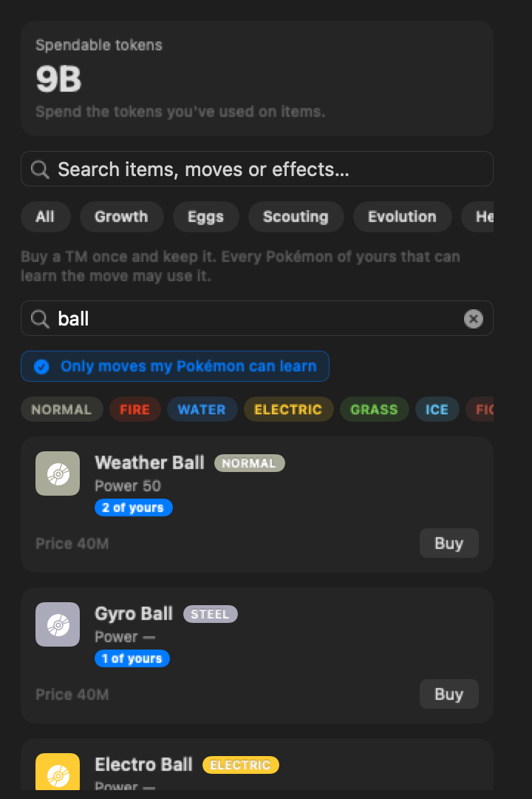</td>
</tr>
<tr>
<td width="55%" valign="middle">
<h3>📊 Official limits, now for Antigravity too</h3>
Antigravity 2.0 and the IDE report real quota, not an estimate. Gemini models and Claude &amp; GPT models each get their own <b>5-hour</b> and <b>weekly</b> buckets with reset countdowns, alongside Claude Code and Codex. Background reads use the token file and can refresh OAuth credentials automatically; a manual refresh may still access the Keychain.
</td>
<td width="45%" align="center">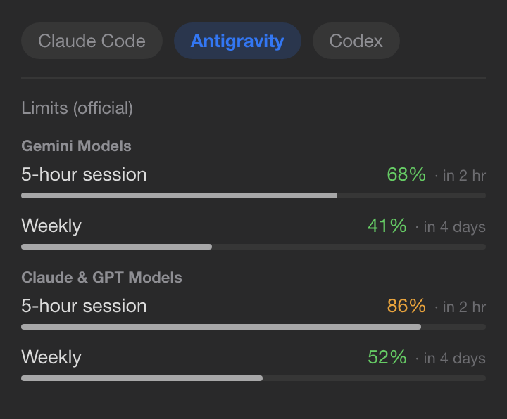</td>
</tr>
<tr>
<td width="45%" align="center">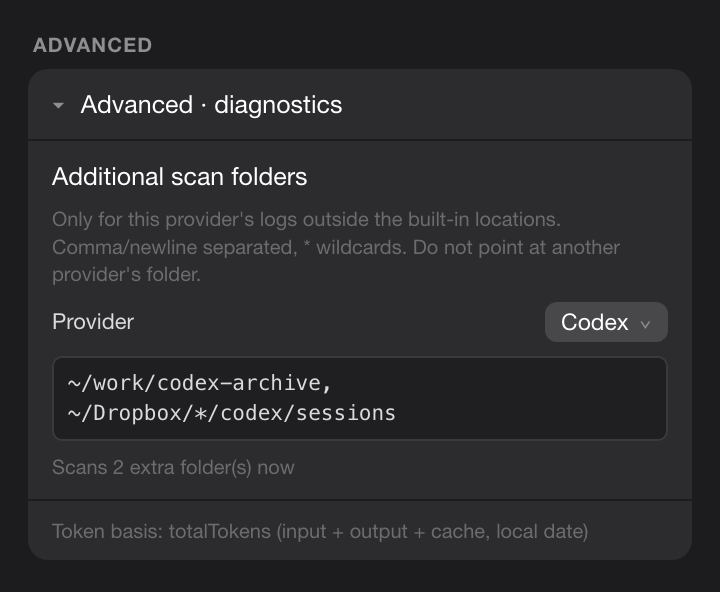</td>
<td width="55%" valign="middle">
<h3>📁 Logs somewhere unusual? Point at them</h3>
If a tool keeps its sessions outside the built-in paths, add your own roots under <b>Settings → Advanced</b> — comma or newline separated, <code>*</code> wildcards, with a live count of how many extra folders currently match. Every provider keeps its own list, so one tool's folders are never handed to another tool's parser, and your custom roots are added to the built-in ones rather than replacing them.
</td>
</tr>
<tr>
<td width="55%" valign="middle">
<h3>🔑 Official limits without the Keychain</h3>
If the cached limit token expires, official Claude limits used to freeze until a refresh — and that press could raise a Keychain password prompt. Paste a <b>claude.ai session key</b> under <b>Settings → Advanced</b> instead: limits then come straight from claude.ai with no Keychain access at all, auto-polling keeps them fresh, and the key is validated the moment you save it.
</td>
<td width="45%" align="center">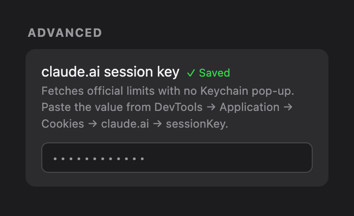</td>
</tr>
<tr>
<td width="45%" align="center">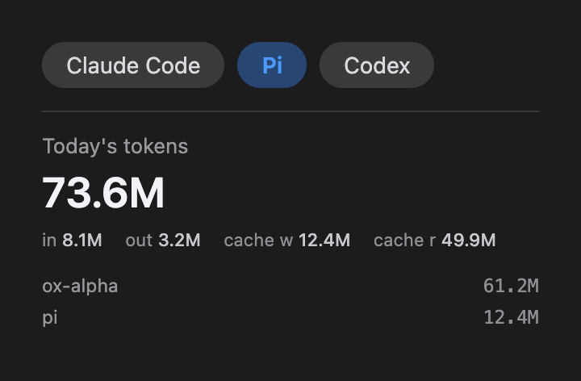</td>
<td width="55%" valign="middle">
<h3>🧮 One session log, several models</h3>
Pi can route more than one model through a single session log. Usage is now attributed to the <b>real model id</b> instead of a flat "pi", and when a day spans several models the popover breaks today's tokens down per model, biggest first.
</td>
</tr>
<tr>
<td width="45%" align="center">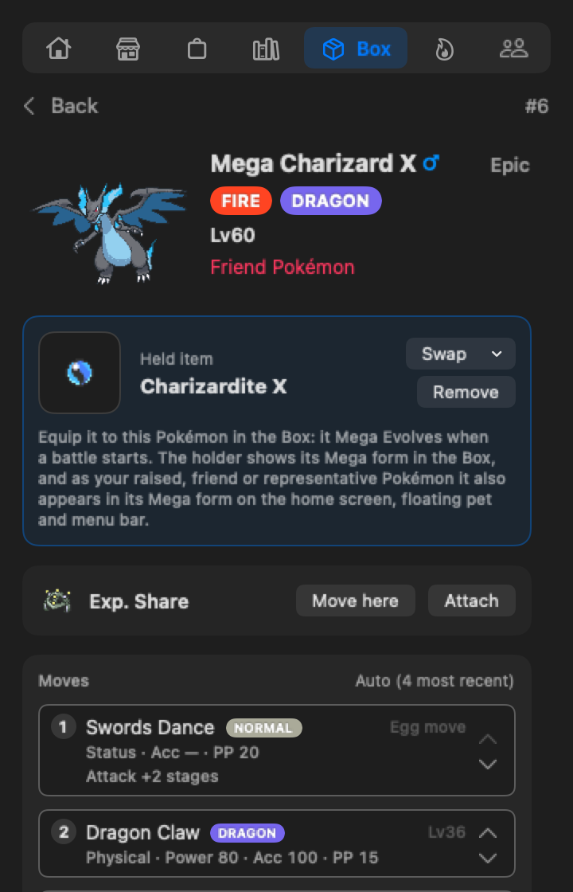<br><br>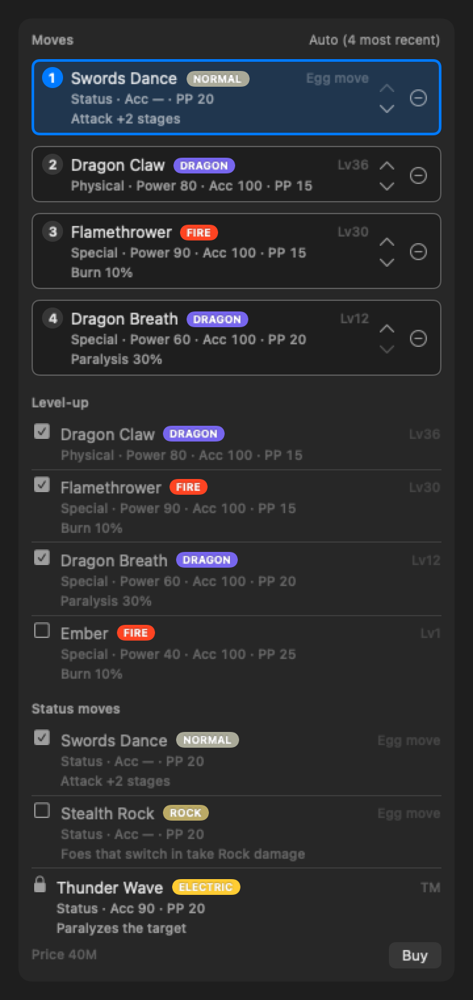<br><br>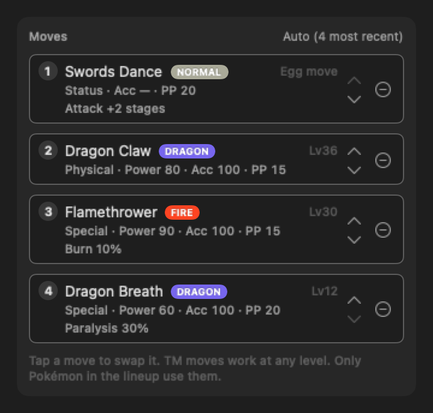<br><br>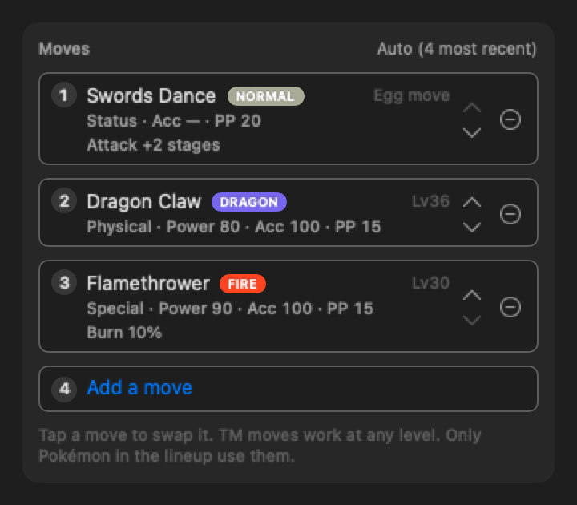</td>
<td width="55%" valign="middle">
<h3>Every Pokémon has its own profile</h3>
Open a Pokémon in the <b>Box</b> to inspect it: level, gender, nature, ability, IVs, calculated stats, held item, and moves. Species descriptions, abilities, and moves use your selected language, with English as the fallback when PokéAPI has no translation.
<br><br>
<b>Status moves</b> join the move picker in their own group when the Pokémon learns them by level-up, by TM or as an egg move. Every Gen 9 status move that does something in a one-on-one battle works: stat changes, healing, Protect and Substitute, status conditions, Taunt and Encore, the screens, hazards and terrains, type, ability and item changers, Baton Pass and the other switching moves, and move callers like Metronome. A few do nothing in singles and stay out of the picker: Whirlwind and Roar, the trapping moves (Mean Look, Block, Spider Web, Fairy Lock), After You and Quash, Attract and Captivate, Wide Guard and Instruct. In battles your Pokémon uses them by the same rules as the trainers.
<br><br>
Each move slot is its own card. The <b>▲/▼</b> buttons on a filled slot swap it with the one above or below, so you can change the order without picking the moves again. The <b>⊖</b> (Forget) button empties a slot, so the Pokémon battles with only the moves you keep; at least one move stays.
</td>
</tr>
<tr>
<td width="55%" valign="middle">
<h3>📚 Exp. Share for the Pokémon in the Box</h3>
Attach an <b>Exp. Share</b> from the Bag to one Pokémon in the Box, from its detail page. It then gets 50% of the EXP your current Pokémon or egg earns, so a graduate keeps growing while you raise the next one. Detach it there too. When a <b>Pokémon Egg</b> sends your current Pokémon to the Box, one Exp. Share from your Bag goes on it.
<br><br>
An Exp. Share can also move between Pokémon: <b>Move here</b> on a Box page picks the holder to take it from, even when the Bag is empty. A holder in the Box evolves there through steps that need only EXP, a level, friends or a type. Steps that need an item, a trade, pets or a battle wait, and the Box page shows the next step.
</td>
<td width="45%" align="center">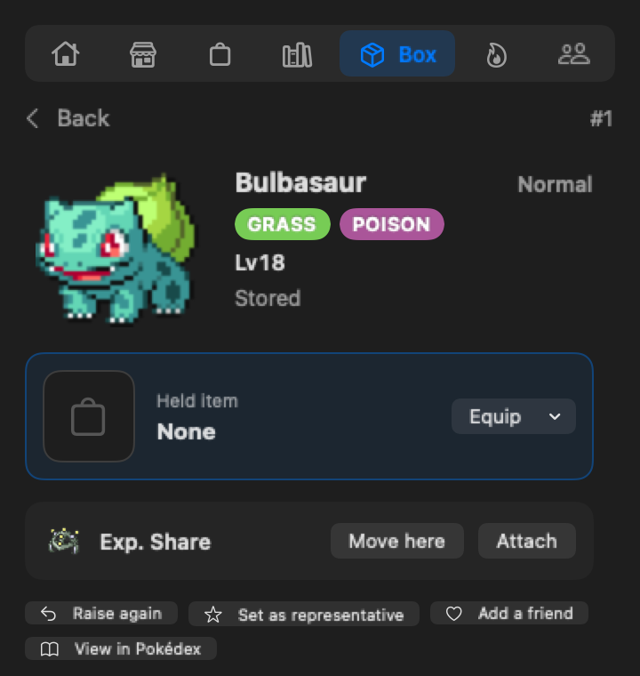</td>
</tr>
<tr>
<td width="45%" align="center">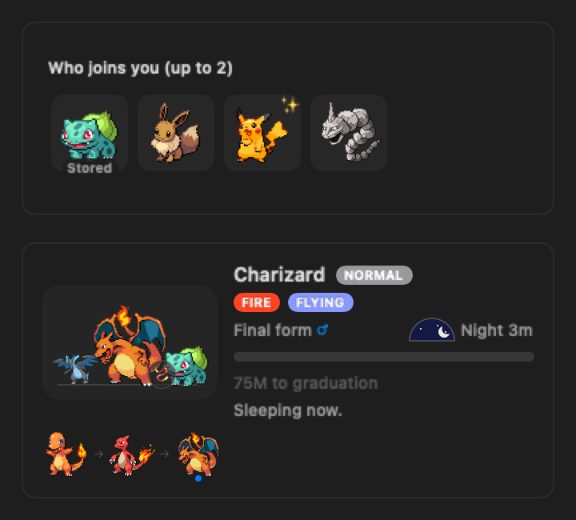</td>
<td width="55%" valign="middle">
<h3>🤝 Box Pokémon walk with you too</h3>
A Pokémon waiting in the Box can be a friend, not only a graduate. The picker marks it <b>Stored</b>. It walks beside your Pokémon on Home and with the floating pet in its current form, and it leaves the friend list when you raise it again. When a Pokémon Egg or a scout sends your Pokémon to the Box while a friend slot is free, it joins as a friend.
</td>
</tr>
<tr>
<td width="55%" valign="middle">
<h3>➡️ A stuck Pokémon moves on by itself</h3>
Sometimes your Pokémon has all the EXP it needs, but its next step waits on something only you can do, such as pets, a friend or an item. Home then shows what it needs and how long until it moves on. If you don't open the app for 30 minutes, it goes to the Box with its progress. The Box Pokémon closest to its next step takes its place, or a new egg starts if there is none. Press <b>Keep waiting</b> to keep that Pokémon until it evolves.
<br><br>
An Exp. Share on a Box Pokémon that can't use more EXP moves to the next closest one, or back to the Bag. A fully grown holder with no step left graduates by itself into your Pokédex, and its Exp. Share moves on the same way. An Exp. Share left in the Bag goes on the Pokémon closest to its next step by itself, but never back on one you took it off yourself. Turn all of this off under <b>Settings › General</b>.
</td>
<td width="45%" align="center">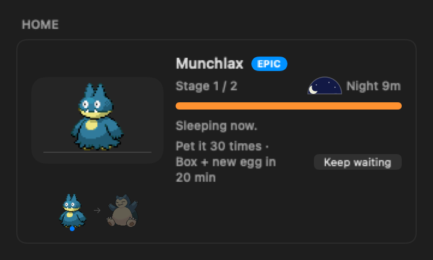</td>
</tr>
<tr>
<td width="45%" align="center">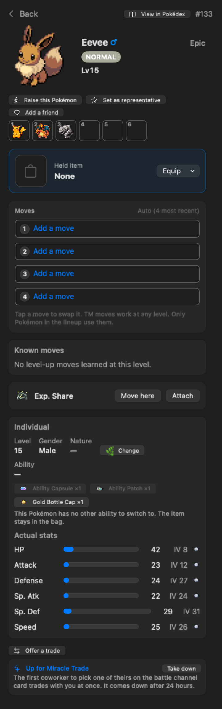</td>
<td width="55%" valign="middle">
<h3>✨ Miracle Trade</h3>
<b>Put up for Miracle Trade</b> on a tradable Pokémon's Box page posts it as a card in the YPoke battle channel. The first coworker to press <b>교환하기</b> (Trade) on the card and pick one of their own tradable Pokémon trades with you at once. The card then shows who got what, you both get a DM, and both Pokémon arrive like any other trade. You can have one offer up at a time. It is kept out of other trades, comes down with <b>Take down</b> on the Box page or the card, and expires after 24 hours. The button shows only when the bot has a battle channel.
<br><br>
Pokémon pick lists in Slack now tell look-alikes apart by sex, shininess and nature, then #2/#3.
</td>
</tr>
<tr>
<td width="55%" valign="middle">
<h3>🧪 Ability, nature, IVs and form, like a trainer's team</h3>
What a gym trainer's team can field, yours can too. The <b>Mint</b> no longer re-rolls: <b>Change</b> next to the nature on Home or a Box page opens a 5×5 chart. Rows raise a stat, columns lower one, and the neutral natures sit on the diagonal. Pick a nature and confirm; with no Mint in the Bag, the confirm buys one and uses it.
<br><br>
The Shop's Growth tab adds the <b>Ability Capsule</b> (the other regular ability), the <b>Ability Patch</b> (regular ↔ hidden ability), the <b>Bottle Cap</b> (one IV to 31) and the <b>Gold Bottle Cap</b> (all six IVs). Three key items switch forms and are never used up: the <b>Reveal Glass</b> (Incarnate ↔ Therian), the <b>DNA Splicers</b> (Kyurem) and the <b>Reins of Unity</b> (Calyrex). A form brings its own types, ability and stats to your battles.
</td>
<td width="45%" align="center">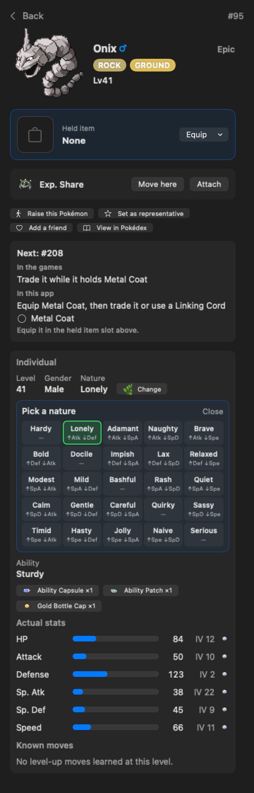</td>
</tr>
<tr>
<td width="55%" valign="middle">
<h3>🌱 Egg moves with the Mirror Herb</h3>
The move picker now lists a Pokémon's attacking <b>egg moves</b> after its TMs. They stay locked until you use a <b>Mirror Herb</b> on that Pokémon. One herb unlocks them for good, along with the egg moves of what it evolved from. Press <b>Use Mirror Herb</b> in the picker, or use one from the Bag. With none in the Bag, the confirm buys one and uses it.
</td>
<td width="45%" align="center">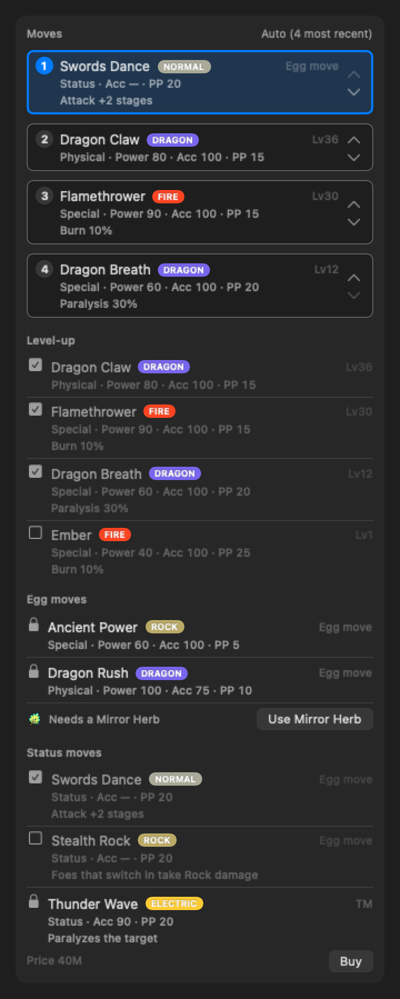</td>
</tr>
<tr>
<td width="45%" align="center">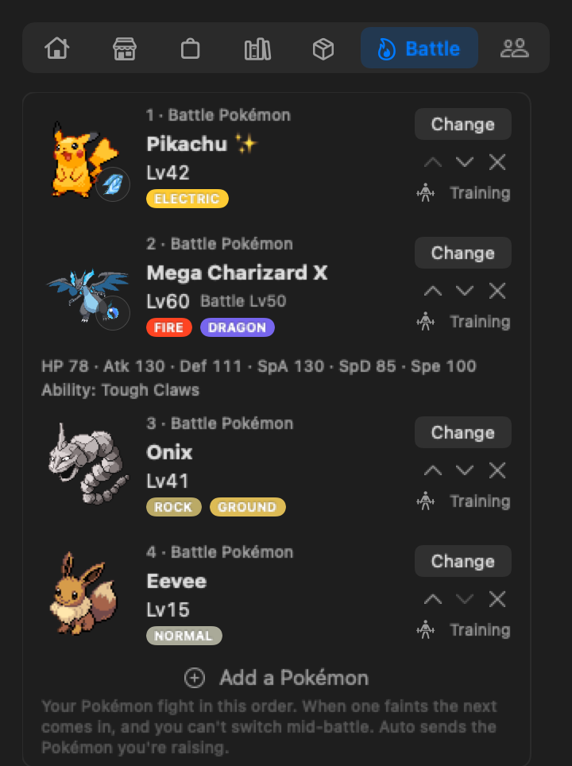<br><br>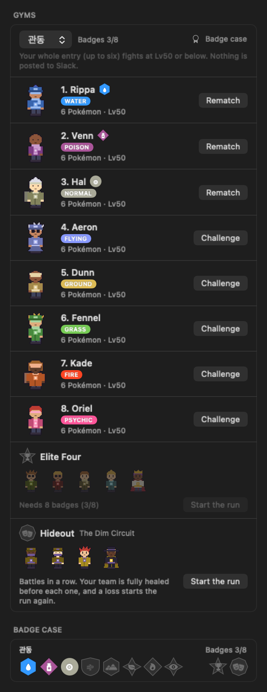</td>
<td width="55%" valign="middle">
<h3>⚔️ Gyms, the Elite Four, and a badge case</h3>
With the <a href="bot/README.md">YPoke</a> link set up, the <b>Battle</b> tab has three sub-tabs. <b>Entry</b> holds up to six Pokémon that fight in order, <b>Battle</b> holds the gyms, and <b>History</b> lists your recent battles. When one faints the next comes in; nothing switches mid-battle. <b>Auto</b> sends the Pokémon you're raising. Each row shows the stats it fights with at its battle level, with ↑ and ↓ on the stats its nature raises and lowers, and follows the Pokémon's form.
<br><br>
Under <b>Gyms</b>, each region has eight leaders with their own type and team, in a two-column grid. Your entry fights at Lv50 or below, and nothing is posted to Slack. A win earns the badge and can grant a TM. Below the gyms, the <b>hideout</b> is a run of battles in a row: your team is fully healed before each one, and a loss starts the run again. Eight badges open the <b>Elite Four</b> run below it. The <b>badge case</b> shows each region's badges.
</td>
</tr>
<tr>
<td width="55%" valign="middle">
<h3>▶️ Watch the battle play out</h3>
A gym fight plays back turn by turn: moves, damage, HP bars, and each side's remaining Pokémon. Moves are named in the app's language. A Pokémon that Mega Evolves or changes form shows that form, in the replay and in the result's team rows. Fast-forward, step to the next turn, or skip to the result. When the replay ends, the next step (for example, Start over) takes the place of Skip.
</td>
<td width="45%" align="center">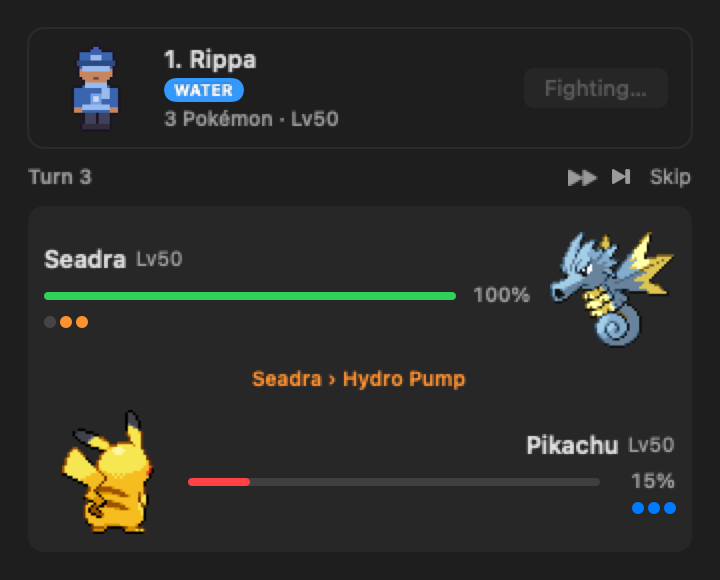</td>
</tr>
<tr>
<td width="45%" align="center">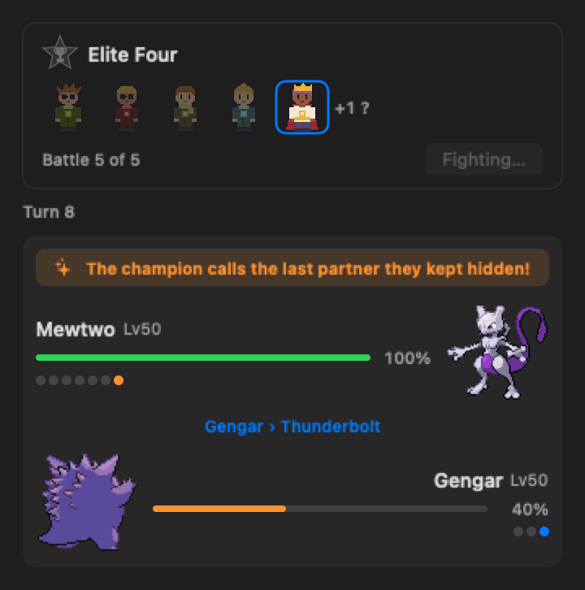</td>
<td width="55%" valign="middle">
<h3>👑 The champion's hidden partner</h3>
Gym leaders field three to six Pokémon of their own type from their region, each with four strong moves and a held item. The champion brings the region's legendaries and keeps one more partner hidden: the run shows <b>+1 ?</b>, and it comes out only after the first six faint, with no healing in between.
</td>
</tr>
<tr>
<td width="55%" valign="middle">
<h3>✨ The hidden boss</h3>
Beat the champion and each region's <b>hidden boss</b> opens below the Elite Four: one battle against six Pokémon and an unrevealed finale. The first win pays a TM with 100+ power, a guaranteed-shiny egg of the region's legendary, 16 Rare Candies and the region's signature items, and adds an emblem to the badge case. The Shop now sells every item an NPC trainer holds, such as the Red and Blue Orbs, plates, resist berries and the Punching Glove.
</td>
<td width="45%" align="center">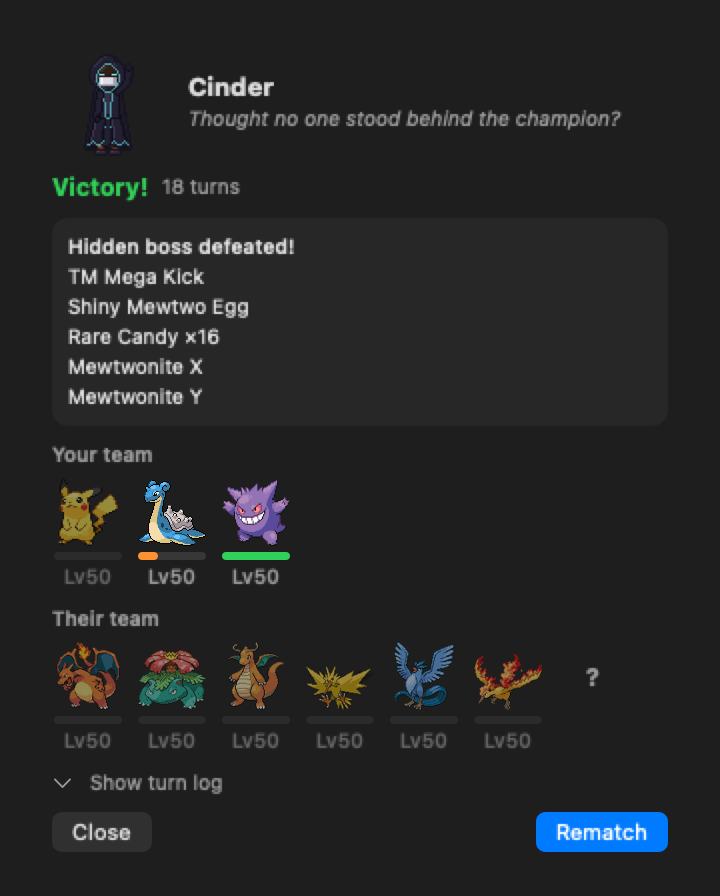</td>
</tr>
<tr>
<td width="45%" align="center"></td>
<td width="55%" valign="middle">
<h3>Choose your growth pace</h3>
Set growth thresholds and shop prices independently from <b>10% to 200%</b>, with Easy/Hard and Cheap/Expensive labels at the slider ends. Dragging only edits a draft; press <b>Save</b> to apply it. Changing growth difficulty preserves your current stage progress instead of triggering an evolution. A hatch from an evolution line you have already graduated grows <b>2× faster</b>. Hover the hatch or growth bar on Home to see used tokens, the target, and progress as a percentage.
</td>
</tr>
<tr>
<td width="45%" align="center"></td>
<td width="55%" valign="middle">
<h3>Choose your activity view</h3>
Choose <b>7, 14, or 21 days, or this month</b> from the bar-chart title. Bars stack by provider when several tools are used; hover for daily totals and the per-tool breakdown. <b>Click the chart</b> to switch to a <b>16-week activity grid</b>, which keeps its own range regardless of the selected bar period. History already stored locally and the labeled recap shortcut stay available on quiet days; a flame badge marks a usage streak of at least two days.
</td>
</tr>
<tr>
<td width="45%" align="center"></td>
<td width="55%" valign="middle">
<h3>Limits you can scan at a glance</h3>
Reset countdowns include the clock time, and the colored percentage stays aligned at the right edge across all quota rows. Choose used or remaining in Settings: both the number and the bar follow that choice.
</td>
</tr>
</table>

## Also in the box

- **Menu-bar shortcuts** — right-click or Control-click for today's summary, Refresh, Pokédex, Settings, floating-pet visibility, and Quit.
- **Low Power Mode** — menu-bar animation continues at Power saver quality.
- **Reconnect refresh** — usage and limits refresh when the network comes back.
- **Representative Pokémon** — pin any owned Pokédex species to the menu bar and optional floating pet, independently of the companion you're raising. While pinned, the menu bar stops following egg, hatch, and evolution changes; raising progress remains visible on Home.
- **Animation quality** — pick how smoothly the menu bar sprite and the floating pet animate (2.5 fps / 5 fps / 10 fps / Original). Both always-visible surfaces share the setting. 2.5 fps is the default and keeps the frame rate the app used before this setting existed; 5 fps and 10 fps trade battery for smoothness (measured idle CPU ~1.8% and ~5.1%). Original plays the floating pet's sprite at its own frame delays (usually 20–30 fps, same as the popover) and uses more battery; the menu bar stays capped at 10 fps, and macOS Low Power Mode still caps the frame rate.
- **Interactive floating pet** — hover for today's usage, pet it with the pointer or a click, click an egg to pray, and right-click for the menu (Open shows the popover). Alerts and small events appear as bubbles.
- **Per-service tabs** — when two or more of Claude Code, Codex, Gemini CLI, Antigravity, OpenCode, Hermes Agent, Cursor, Grok CLI, Copilot CLI, Kiro CLI, Pi Agent, omp, omo, Aside, Kimi Code, and Devin CLI are detected, compact tabs switch between them; today's total stays combined.
- **Official limits** — Claude, Codex, and Antigravity limits with reset countdowns; OpenCode Go 5-hour / weekly / monthly allowances; and Grok CLI weekly subscription credits. Available limits depend on the provider login or subscription.
- **Usage streak** — a flame beside the recap shortcut shows consecutive usage days, from two days onward. It stays gray until today's first usage extends the streak.
- **Sprite recovery** — failed animated-sprite downloads retry automatically while the fallback remains visible.
- **Additional scan folders** — per-provider extra scan roots for logs kept outside the built-in paths (Settings → Advanced).
- **Several Claude accounts** — Claude Code logins kept in their own config folder (`CLAUDE_CONFIG_DIR`) each get a tab under the official limits, with their own gauges, Rare Candy, alerts, and today/month tokens. `~/.claude-*` folders and an exported `CLAUDE_CONFIG_DIR` are found automatically; add others in Settings → Advanced. A folder pinned with `CLAUDE_SECURESTORAGE_CONFIG_DIR` that holds only a `.credentials.json` is found too. A rate-limited account keeps its tab, with a line saying when refresh resumes. The menu bar percentage, companion mood, and forecast follow the account you used last (Settings → General → Tracked Claude account). Each account can take its own claude.ai session key (Settings → Advanced), so its limits keep refreshing without the Keychain.
- **Burn-rate forecast** — projects when the current 5h window hits 100%.
- **In-app updates** — installs new fork releases by itself (checksum-verified), or on one click when automatic updates are off; current version shown in Settings.
- **Usage recap** — a Pokédex-style recap of any week, month, or year (total, meters, comparison, best day, best streak, graduations). Hover a meter for its date and full token count, and jump back to This week / This month / This year in one click. History is kept locally for this year and the last.

- **Local save backups** — automatic snapshots and corruption recovery, with a restore screen in Settings. Backup history starts collapsed; expand it to browse snapshots. **Create snapshot** stays available outside the list.
- **Pokémon forms** — collect Gen 1–5 alternate forms, inspect form-specific individuals, and pin an owned form to the menu bar and floating pet. An individual's form follows evolution and stays in saves and exports; existing Unown letter saves remain readable. See the [form catalog](docs/reference/pokemon-forms.md).
- **Bulk Rare Candy** — use several candies at once and preview the growth before spending.
- **Quota pace** — gauge markers show the elapsed share of a limit window; six color tiers indicate usage pace, and menu-bar limit percentages use the same colors.

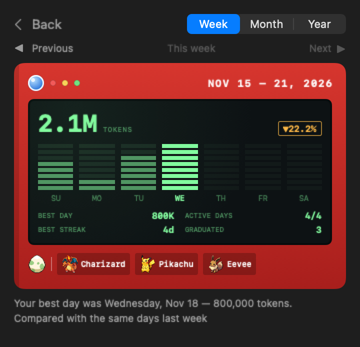

<small>The Home, Settings, form, Shop, Bag, Pokédex, next-evolution, Box, profile, Exp. Share, Battle, gym, replay, champion, floating-friends, stored-friends, difficulty, activity, regional Pokédex, pet-interaction, and recap images above are local renders of the production UI with sample data; the gym images use the YPoke bot's Kanto gym list. The regional and pet boards combine separate native UI component renders. Animated GIFs are illustrative demonstrations and may show an earlier layout.</small>

## Agent activity

The floating pet can follow any AI coding agent: it bobs while the agent works, asks for you in a speech bubble when the agent needs input, and runs to your cursor when the agent finishes. The agent reports through a URL:

Setup is manual and optional: PokeTokenBar does not install agent hooks or edit your agent settings. Enable the floating pet, leave **React to agent activity** on, and add the appropriate hook below.

```text
poketokenbar://agent?state=<working|waiting|done|idle>[&label=<name>][&message=<text>]
```

- `label` and `message` are optional, URL-encoded, and shown as plain text. `label` (up to 24 characters) names the agent so several can run at once, each with its own state. Without a label, all events belong to one agent.
- `working` falls back to idle after 10 minutes without news. `done` shows for about 6 seconds, then the pet walks home. `waiting` stays until that agent's next event or until you click the pet.
- With several agents, a question comes first: the bubble shows the latest waiting agent and how many more are waiting, and the pet keeps bobbing while any agent works. A `done` shows its label for a few seconds, then the earlier bubble comes back. Clicking the pet clears every question, then prays when an egg is shown or pets a hatched Pokémon. Clicks never open the popover; use right-click → Open or the menu bar icon. Up to 8 labels are tracked.
- A limit alert bubble takes priority. With Reduce Motion or Low Power Mode on, the pet shows bubbles without moving.
- Nothing happens while the floating pet is off. Turn the reactions off in **Settings → Floating Pet → React to agent activity**.

**Claude Code** — save this as `~/.claude/poketokenbar.sh`. It labels each session with its project folder name, so two sessions in the same folder share one label. `pgrep` keeps a hook from relaunching the app after you quit it, and `open -g` keeps your terminal focused.

```sh
#!/bin/sh
# PokeTokenBar agent hook: sh ~/.claude/poketokenbar.sh <working|waiting|done>
# Labels the agent with the project folder name, percent-encoded (perl ships with macOS).
pgrep -xq PokeTokenBar || exit 0
label=$(printf %s "${CLAUDE_PROJECT_DIR##*/}" | perl -pe 's/([^A-Za-z0-9._~-])/sprintf("%%%02X", ord $1)/ge')
open -g "poketokenbar://agent?state=$1&label=$label" >/dev/null 2>&1
exit 0
```

Then add the hooks to `~/.claude/settings.json`. The `Notification` matcher skips Claude Code's idle reminder, which would otherwise leave a "waiting" bubble after every turn. `Stop` does not fire when you interrupt a turn (Esc), so the pet keeps working until the 10-minute timeout or an `idle` event.

```json
{
  "hooks": {
    "UserPromptSubmit": [{ "hooks": [{ "type": "command", "command": "sh ~/.claude/poketokenbar.sh working || true" }] }],
    "PostToolUse": [{ "matcher": "*", "hooks": [{ "type": "command", "command": "sh ~/.claude/poketokenbar.sh working || true" }] }],
    "PreToolUse": [{ "matcher": "AskUserQuestion", "hooks": [{ "type": "command", "command": "sh ~/.claude/poketokenbar.sh waiting || true" }] }],
    "Notification": [{ "matcher": "permission_prompt|elicitation_dialog", "hooks": [{ "type": "command", "command": "sh ~/.claude/poketokenbar.sh waiting || true" }] }],
    "Stop": [{ "hooks": [{ "type": "command", "command": "sh ~/.claude/poketokenbar.sh done || true" }] }]
  }
}
```

**Other agents** — open the URL from any hook or script, e.g. `pgrep -xq PokeTokenBar && open -g 'poketokenbar://agent?state=done&label=my-app&message=Build%20passed' >/dev/null 2>&1 || true`.

## Works with

| Tool | Tracked | Official limits |
|---|---|---|
| **Claude Code** | today · 5h block · week · month | ✅ 5h / weekly |
| **Codex** | today · week · month | ✅ 5h / weekly |
| **Gemini CLI** | today · week · month | — |
| **Antigravity** | today · 5h block · week · month | ✅ 5h / weekly |
| **OpenCode** | today · 5h block · week · month | ✅ 5h / weekly / monthly (OpenCode Go) |
| **Hermes Agent** | today · 5h block · week · month | — |
| **Cursor** | today · 5h block · week · month | — |
| **Grok Build CLI** | today · 5h block · week · month | ✅ credit allowance (weekly) |
| **Copilot CLI** | today · 5h block · week · month | — |
| **Kiro CLI** | today · 5h block · week · month | — (estimated) |
| **Pi Agent** | today · 5h block · week · month | — |
| **omp** (oh-my-pi) | today · 5h block · week · month | — |
| **omo** (senpi) | today · 5h block · week · month | — |
| **Aside** | today · 5h block · week · month | — |
| **Kimi Code** | today · 5h block · week · month | — |
| **Devin CLI** | today · 5h block · week · month | — |

Grok token usage comes from Grok Build CLI's local session logs; weekly subscription credits use the CLI's saved login. If that login expires, run Grok CLI once to refresh it. OpenCode Go limits use the Go API key already saved by OpenCode. Grok Bot cloud usage and its cloud subscription limits are not integrated.

All read locally — no external usage CLI required. Adding a tool is a provider implementation and registration (see [CONTRIBUTING.md](CONTRIBUTING.md)).

## Install

### Requirements

macOS 14+ (Apple Silicon or Intel). That's it — token usage is read directly from local Claude Code, Codex, Gemini CLI, Antigravity, OpenCode, Hermes Agent, Cursor, Grok CLI, Copilot CLI, Kiro CLI, Pi Agent, omp, omo, Aside, Kimi Code, and Devin CLI data, with no external usage CLI required.

### Install or upgrade

Release builds of this fork are **Apple Silicon only**. Quit PokeTokenBar first if it is running, then:

```bash
curl -L https://github.com/w8385/PokeTokenBar-yp/releases/latest/download/PokeTokenBar-yp-arm64.zip -o /tmp/PokeTokenBar-yp.zip \
  && ditto -x -k /tmp/PokeTokenBar-yp.zip /Applications \
  && xattr -dr com.apple.quarantine /Applications/PokeTokenBar.app \
  && open /Applications/PokeTokenBar.app
```

Upgrading keeps your progress: save data stays in `~/Library/Application Support/PokeTokenBar`.
From v2.5.7-yp7 on, the app updates itself: it installs a new release while the popover is closed and reopens. Turn this off in Settings → Updates → Automatic updates.

The fork has no Homebrew cask. `chattymin/tap/poke-token-bar` installs the upstream app, which lacks the fork features.

### Downloaded with a browser?

Unzip it and move `PokeTokenBar.app` into `/Applications`. The app is ad-hoc signed (not notarized), so Gatekeeper shows an "unidentified developer" warning on first launch. Clear it once, either way:

- **Finder:** right-click (or Control-click) `PokeTokenBar.app` → **Open** → **Open** again in the dialog.
- **Terminal:** `xattr -dr com.apple.quarantine /Applications/PokeTokenBar.app`

### Build from source

```bash
swift build                  # debug
swift test                   # unit tests
./scripts/build-app.sh       # release → PokeTokenBar.app → /Applications
```

## Data sources

| Source | Used for | Notes |
|---|---|---|
| `~/.claude/projects/**/*.jsonl`, `<config folder>/projects/**/*.jsonl` | Claude Code daily/blocks/weekly/monthly | read directly; deduped by message id; cached incrementally |
| `~/.claude.json`, `~/.claude-*/.claude.json` | Claude accounts: which config folders are logged in, and their names | only the `oauthAccount` block is used; folders from an exported `CLAUDE_CONFIG_DIR` or Settings → Advanced are added |
| `~/.claude/history.jsonl`, `<config folder>/history.jsonl` | Claude tokens per account; the account used last | only session ids and prompt times are read, never the prompt text; only new lines are read |
| `~/.gemini/tmp/**/chats/*.json(l)` | Gemini CLI daily/monthly | session records (`tokens` per message); weekly = daily sum |
| `~/.gemini/antigravity/conversations/*.db`<br>`~/.gemini/antigravity-cli/conversations/*.db`<br>`~/.gemini/antigravity-ide/conversations/*.db` | Antigravity daily/blocks/weekly/monthly | SQLite read-only; per-call usage from the Cascade protobuf blob; supports Antigravity 2.0/Core, CLI & IDE; its own provider, not folded into Gemini; a subscription, so no cost is estimated |
| `~/.codex/sessions/**/*.jsonl` | Codex daily/monthly | `token_count` events; weekly = daily sum |
| `~/.local/share/opencode/opencode.db` | OpenCode daily/blocks/weekly/monthly | SQLite read-only (`message` on V1, `session_message` on V2); legacy `storage/message` JSON is also supported |
| `~/.hermes/state.db` | Hermes Agent daily/blocks/weekly/monthly | SQLite read-only; session token totals and persisted cost |
| `~/Library/Application Support/Cursor/User/globalStorage/state.vscdb` | Cursor daily/blocks/weekly/monthly | SQLite read-only fallback (`cursorDiskKV` bubble `tokenCount`); when signed in, primary source is `cursor.com` dashboard API (see Privacy) |
| `cursor.com` (dashboard API) | Cursor daily/blocks/weekly/monthly | unofficial JSON endpoint (`get-filtered-usage-events`); session from `cursorAuth/accessToken` in `state.vscdb` or `CURSOR_SESSION_TOKEN`; refetches when the provider reloads; on network error falls back to an account-scoped disk cache up to 6 h old; disable with `CURSOR_USAGE_API=0` |
| `opencode.ai` (OpenCode Go usage API) | OpenCode Go official 5h / weekly / monthly usage | unofficial JSON endpoint the opencode.ai console uses (`/zen/go/v1/usage`); Bearer OpenCode Go API key from OpenCode's `credential` table in `opencode.db`, falling back to `auth.json`; only when a Go key exists, failure hides the limits only |
| `cli-chat-proxy.grok.com` (Grok billing API) | Grok official credit allowance for the current period | unofficial JSON endpoint behind the Grok CLI `/usage` modal (`/v1/billing?format=credits`); Bearer access token from `$GROK_HOME/auth.json` (default `~/.grok`); never refreshes the token itself, so an expired login asks you to run Grok once; failure hides the limits only |
| `api2.cursor.sh` (dashboard limits API) | Cursor official monthly included usage | Connect RPC `GetCurrentPeriodUsage`; Bearer JWT from `state.vscdb` or `CURSOR_SESSION_TOKEN`; same disable switch as usage events |
| `~/.grok/sessions/**/updates.jsonl` | Grok Build CLI daily/blocks/weekly/monthly | `turn_completed` records (per-turn `usage`, server-reported cost); honours `$GROK_HOME`; subagent sessions are skipped because their tokens are already folded into the parent turn |
| `~/.copilot/session-store.db` | Copilot CLI daily/blocks/weekly/monthly | SQLite read-only; one `assistant_usage_events` row per API call; honours `$COPILOT_HOME`; `input_tokens` already contains the cached prompt, so cache reads/writes are subtracted; premium-request billing, so no cost is estimated |
| `~/Library/Application Support/kiro-cli/data.sqlite3`<br>`~/.kiro/sessions/cli/*.jsonl`<br>`~/.kiro/sessions/<ws>/<session>/messages.jsonl` | Kiro CLI daily/blocks/weekly/monthly | Pre-2.20 SQLite plus 2.20+ / `--v3` JSONL; neither store records real token counts, so input is a bytes÷4 **estimate** of accumulated conversation text resent on every turn; `usage_summary` credits are not converted to USD; a `/clear`d SQLite conversation's already-counted tokens stay counted until the app restarts; honours `$KIRO_CLI_HOME` and `$KIRO_HOME` |
| `~/.pi/agent/sessions/**/*.jsonl` | Pi Agent daily/blocks/weekly/monthly | Direct persisted usage from all projects; `$PI_CODING_AGENT_DIR` and `$PI_CODING_AGENT_SESSION_DIR` overrides supported; output already includes reasoning (not counted twice); forked history deduplicated by entry ID; source-recorded costs are retained |
| `~/.omp/agent/sessions/**/*.jsonl` | omp (oh-my-pi) daily/blocks/weekly/monthly | pi-format session JSONL; every assistant `usage` event is summed (rewound branches are already billed) and subagent session files count too, since their tokens are not folded into the parent; honours `$OMP_CODING_AGENT_DIR`; per-event `cost` is trusted when reported; `bridge/` conversion copies are skipped because their originals are already counted at the source |
| `~/.omo/agent/sessions/**/*.jsonl`<br>`~/.senpi/agent/sessions/**/*.jsonl` | omo (senpi) daily/blocks/weekly/monthly | pi-format session JSONL from senpi `docs/session-format.md`; assistant usage, nested `toolResult.usage`, and compaction/branch-summary usage are summed; output already includes reasoning; `cacheWrite1h` is added to cache write; honours `$OMO_CODING_AGENT_DIR` and `$SENPI_CODING_AGENT_DIR`; recorded `usage.cost` is a price estimate, not a subscription invoice |
| `~/.aside/u/*/state.db` | Aside daily/blocks/weekly/monthly | Read-only SQLite turn totals; deleted turns remain counted until the scan cache resets; only recorded costs are used |
| `~/.kimi-code/sessions/**/agents/*/wire.jsonl` | Kimi Code daily/blocks/weekly/monthly | Every `usage.record` (per-request, `turn` and `session` scope) is summed across main and subagent wire files; honours `$KIMI_CODE_HOME` and the Kimi desktop runtime root; `/fork` copies are folded by record content; Kimi records no cost, so cost shows as unavailable |
| `~/.local/share/devin/cli/sessions.db` | Devin CLI daily/blocks/weekly/monthly | Read-only SQLite `message_nodes` metrics joined to the session model; input and cache buckets are distinct; branch copies are deduplicated by message ID within each session; honours `$XDG_DATA_HOME` and additional scan folders; no cost is estimated |
| Keychain (`Claude Code-credentials`, plus `Claude Code-credentials-<hash>` for each other config folder) / `<config folder>/.credentials.json` → `api.anthropic.com` | Claude official 5h/weekly % per account | unofficial endpoint; the Keychain is read **only when you press refresh** — auto-polling never reads it |
| `codex app-server` | Codex official 5h/weekly % | local child process; account snapshot only, no model turn |
| [PokéAPI](https://pokeapi.co/) — `pokeapi.co`, `graphql.pokeapi.co` | Pokémon species, stats, abilities, moves &amp; evolution | runtime fetch; cached locally, never bundled |
| `raw.githubusercontent.com/PokeAPI/sprites` | Pokémon &amp; item sprites | runtime fetch; cached under Application Support, never bundled |
| `status.claude.com`, `status.openai.com` | provider incident banner | statuspage summary; display only — turn it off in Settings |
| `api.github.com` | update check | latest release tag; on launch, every 30 minutes and when the popover opens |
| `github.com` release assets (via `release-assets.githubusercontent.com`) | update install | the release zip and its `.sha256`; only when a newer release is installed |

If a provider's logs live **outside** those built-in paths, add the folder in **Settings → Advanced → Additional scan folders**. Pick the provider first — each folder is parsed only by that provider, so pointing a Gemini field at Claude logs would mis-attribute tokens. Extra folders are added to the built-in locations; they never replace them.

## Privacy & permissions

- **On-device first.** Token usage is read directly from local Claude Code, Codex, Gemini CLI, Antigravity, OpenCode, Hermes Agent, Cursor, Grok CLI, Copilot CLI, Kiro CLI, Pi Agent, omp, omo, Aside, Kimi Code, and Devin CLI data. The app never uploads usage or runs model turns. To split Claude usage between accounts, each config folder's `history.jsonl` is read for session ids and prompt times only; the prompt text is ignored and nothing leaves the Mac.
- **Outbound requests.** The app is not fully offline. It talks to fifteen hosts: `pokeapi.co` and `graphql.pokeapi.co` (species/evolution), `raw.githubusercontent.com` (sprites), `api.anthropic.com` (Claude official limits), `claude.ai` (Claude official limits when you save an optional claude.ai session key in Settings — the key only, no prompts or project paths), `cursor.com` (Cursor usage summary when you are signed into Cursor locally — session credential only, no prompts or project paths), `api2.cursor.sh` (Cursor official monthly included usage — Bearer JWT only, same credential class as the IDE login), `opencode.ai` (OpenCode Go official limits when an OpenCode Go key is connected locally — the API key only), `cli-chat-proxy.grok.com` (Grok official credit allowance when you are signed into Grok CLI — its access token only), `cloudcode-pa.googleapis.com` and `daily-cloudcode-pa.googleapis.com` (Antigravity official limits) plus `oauth2.googleapis.com` (their token refresh), `status.claude.com` and `status.openai.com` (incident banner — off switch in Settings), and `api.github.com` (update check). **None of them carry your usage logs, prompts, or project paths** — only the request itself (Cursor sends your session cookie to fetch your own usage rows, same as the web dashboard).
- **Keychain (optional).** The Claude OAuth credential is read **only when you press a refresh button** (Settings, or the limits row in the popover). Automatic polling never touches the Keychain, so it never raises a password prompt; when `~/.claude/.credentials.json` is present, each poll re-reads it, so an in-place `/login` to another account is picked up without pressing refresh. The token is held in memory only — the app creates no Keychain item of its own. If there is no credentials file, limits stay on the cached token until it expires or you refresh. Turn it off in Settings — the limits section simply hides. With several Claude accounts, a refresh also reads each other config folder's own item, once per folder, and a declined prompt stops the remaining ones.
- **Pokémon data and assets** are fetched at runtime from PokéAPI and cached only under `~/Library/Application Support/PokeTokenBar/`. Generated individual values (such as IVs, gender, ability and known moves) are stored in the local companion save so they remain stable. The app binary and its release artifacts contain no Pokémon assets.

## Contributors

Contributions of all sizes are welcome — see [CONTRIBUTING.md](CONTRIBUTING.md) for how to build, test, and open a pull request.

[](https://github.com/chattymin/PokeTokenBar/graphs/contributors)

## License & disclaimer

**MIT** — see [LICENSE](LICENSE). The MIT license covers this project's original source code only; it grants no rights to any third-party trademarks, artwork, or data accessed through the app.

PokeTokenBar is an **unofficial, non-commercial fan project**. It is **not affiliated with, endorsed, sponsored, or approved by Nintendo, Game Freak, Creatures Inc., or The Pokémon Company.** "Pokémon" and all related names, characters, and imagery are trademarks and copyrights of their respective owners. This project claims no ownership of, and asserts no rights over, any Pokémon intellectual property.

- **The app binary and its release artifacts bundle no Pokémon assets.** Pokémon species data and sprites are fetched **at runtime** from the public [PokéAPI](https://pokeapi.co) and cached locally on the user's own device; sprite images served via PokéAPI remain the property of their respective owners.
- Any Pokémon imagery in this repository's documentation (screenshots/GIFs) is shown solely to illustrate the app's functionality.
- The app is provided free of charge for **personal, non-commercial use only.**
- If you are a rights holder with any concern about this project, please open an issue or contact the maintainer, and we will respond promptly.

*Provided "as is", without warranty of any kind. This notice is not legal advice.*
